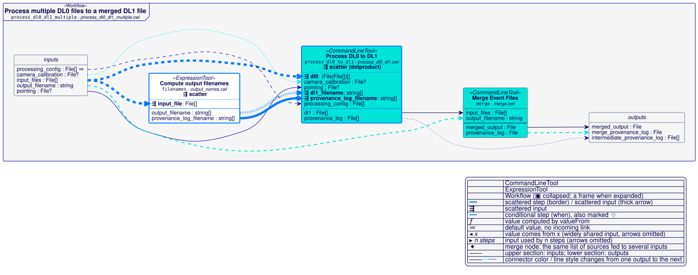
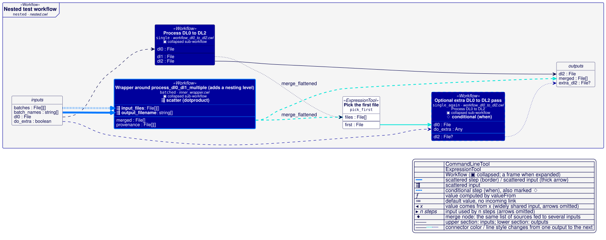
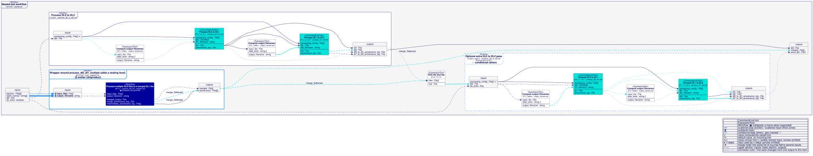
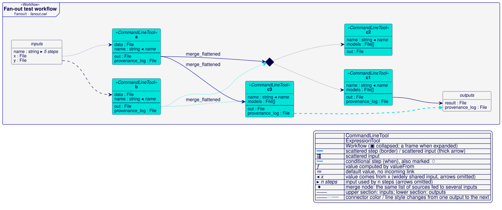

Usage
=====

``cwl-plantuml`` reads a CWL workflow with ``cwltool`` (with full validation;
sub-workflows are resolved by cwltool) and writes a PlantUML diagram showing
every step with its input and output ports, the connections between them,
scatter, conditionals and (optionally) the inside of sub-workflows.

.. code-block:: shell

   $ cwl-plantuml workflow.cwl                        # PlantUML to stdout
   $ cwl-plantuml workflow.cwl -o wf.puml --render svg
   $ cwl-plantuml workflow.cwl -d 0 -o wf.puml        # sub-workflows as black boxes

``--render`` runs the ``plantuml`` executable (in headless mode), which must
be installed separately (it needs Java).

Options
-------

``-d/--depth N``
   Number of sub-workflow levels to expand below the top level. ``0`` shows
   only the top-level steps, drawing sub-workflows as collapsed
   ``«Workflow»`` boxes; ``1`` also expands sub-workflows called directly from
   the top level, and so on. Default: ``all``.

``--max-fanout N``
   A workflow input feeding more than ``N`` steps is not drawn with arrows:
   each destination row shows ``◂ input_name`` and the input row shows
   ``▸ n steps``. ``0`` always draws arrows. Default: ``4``.

``--hide-ports REGEX``
   Hide every port (and its arrows) whose name matches ``REGEX``, e.g.
   ``--hide-ports provenance``.

``--no-merge-nodes``
   Draw every source arrow separately instead of through shared merge nodes.

``--monochrome-connectors``
   Draw every connector plain instead of cycling color/line style per output.

``--all-inputs``
   Also list tool inputs that the step does not bind (in italics, marked
   "(unbound)").

``--no-types``, ``--no-legend``, ``--top-to-bottom``, ``--title TEXT``
   Hide port types, hide the legend, lay out vertically, set a title.

``--render png|svg|pdf``
   Run ``plantuml`` on the output file (requires ``--output``).

Diagram conventions
-------------------

* Colors follow the CTAO brand palette. Galaxy Blue is used for text,
  borders and arrows.
* Every step is a box with the stereotype ``«CommandLineTool»`` (Cherenkov
  Blue), ``«ExpressionTool»`` (White), ``«Workflow»`` (Interstellar Indigo)
  or ``«Operation»`` (Galaxy Blue). The title is the step's ``label``, falling
  back to the ``label`` of the tool/workflow it runs, then to the step id. The
  step id and the file it runs follow in small print.
* The upper section of a box lists the step **inputs**, the lower section the
  **outputs**. Arrows go from the exact output row to the exact input row.
* An **expanded sub-workflow** is a frame (Interstellar Indigo border, fill
  alternating Moon Gray / White with nesting depth) containing an ``inputs``
  box, its steps and an ``outputs`` box. A **collapsed** sub-workflow (below
  ``--depth``) is an indigo box marked ``▣ collapsed sub-workflow``.
* **Scatter**: the step (or sub-workflow frame) has a bold Cosmic Azure border
  and a ``⇶ scatter (method)`` badge. Scattered inputs are bold with ``⇶``,
  and the arrows feeding them are thick and Cosmic Azure (keeping the line
  style of their source).
* **Conditional** (``when``) steps have a dashed Cosmic Azure border and a
  ``◇ conditional`` badge.
* **Merge nodes** (◆): when several inputs receive exactly the same list of
  sources (same order, same ``linkMerge``/``pickValue``), the sources are drawn
  once into a diamond, with one arrow from it to each input.
* **Connector styles**: all arrows leaving one output share a color/line
  style, which changes from one output to the next, so that arrows are easier
  to follow.
* ``ƒ`` marks an input computed by ``valueFrom``, ``≔`` an input using its
  default with no incoming link. ``linkMerge``/``pickValue`` appear as edge
  labels.

Examples
--------

A workflow with scattered steps:

A workflow with sub-workflows (one of them scattered, one conditional), with
``--depth 0`` and ``--depth 1``:

A widely shared input (``name``, see ``--max-fanout``) and a merge node:

Design notes
------------

:mod:`cwl_plantuml.model` builds a renderer-neutral graph, keyed by the path
of step names in the hierarchy (not by CWL ids), so the same sub-workflow file
used by two steps is drawn twice. :mod:`cwl_plantuml.simplification` reduces the
number of connectors, and :mod:`cwl_plantuml.render` emits the PlantUML.

A PlantUML *class diagram* is used rather than a component diagram: PlantUML
can attach arrows to individual class members, and Graphviz then routes each
arrow to the exact row, whereas component ``portin``/``portout`` ports are
placed on arbitrary sides of the box. PlantUML matches ``Class::member`` by
the first member whose text *contains* that string (``dl1`` would match
``dl1_filename``), so each row carries an invisible unique token
(``Qx00042x``) and links refer to the token. If a future PlantUML version
changes this matching rule, arrows would attach to box borders instead of
rows; check a rendered diagram after upgrading PlantUML.
